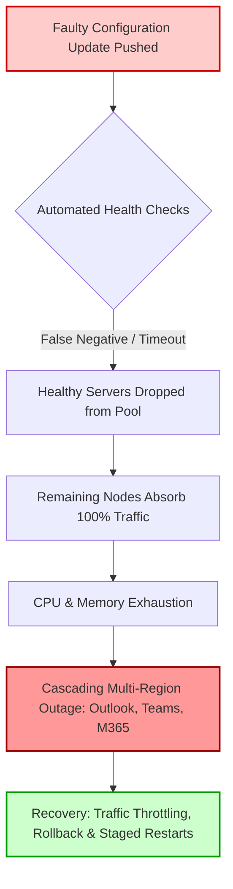

# 🌐 Anatomy of a Global Cloud Outage: Microsoft 365 Incident Analysis

## 📌 Executive Summary
On November 12–13, 2026, Microsoft experienced a widespread global service disruption affecting core platforms including **Outlook, Microsoft Teams, Exchange Online, Copilot, and Xbox Live** across more than 74 countries. What began as an internal server health-check failure rapidly escalated into a multi-region cascading overload.

This repository breaks down the possible root-cause domains, simulates the infrastructure load mechanics behind cascading failures, and outlines architectural safeguards to prevent similar disruptions.

---

## 🔍 Potential Root-Cause Domains & Failure Modes

When a hyperscale cloud provider goes down globally, engineers evaluate four primary failure domains:

### 1. Configuration & Health-Check Loops *(Confirmed Primary Trigger)*
* **Mechanism:** A faulty configuration update causes automated health probes to falsely flag healthy application servers as unresponsive.
* **Impact:** Load balancers automatically pull these servers out of the active pool, shrinking total global compute capacity within minutes.

### 2. Cascading Traffic Overload *(Confirmed Secondary Amplifier)*
* **Mechanism:** As active nodes drop offline, 100% of incoming user traffic is rerouted to the remaining healthy servers.
* **Impact:** Surviving nodes hit 100% CPU and memory saturation, causing them to crash or time out—creating a domino effect across regions.

### 3. Edge Routing & DNS/BGP Misconfigurations *(Common Cloud Risk)*
* **Mechanism:** Errors in Border Gateway Protocol (BGP) announcements or Azure Front Door routing rules prevent user requests from reaching healthy data centers.
* **Impact:** Services appear completely unreachable globally even if backend databases remain intact.

### 4. Identity & Token Validation Bottlenecks *(Entra ID / Auth Layer)*
* **Mechanism:** Retry storms occur when millions of clients simultaneously attempt to refresh expired authentication tokens.
* **Impact:** Authentication servers become overwhelmed, locking users out of all dependent productivity apps simultaneously.

---

## 📊 Cascading Failure Architecture Flow

---

## 🛡️ Engineering & Architecture Takeaways
1. **Circuit Breakers & Load Shedding:** Systems must intentionally drop low-priority requests (graceful degradation) rather than allowing all servers to crash under 100%+ load.
2. **Staged Canary Rollouts:** Configuration updates should roll out to <1% of global nodes first, with automatic rollback triggers if health-check failure rates spike.
3. **Exponential Backoff on Client Retries:** Client apps (like Outlook and Teams) should randomize retry intervals to prevent "thundering herd" traffic spikes during recovery.

---

## 💻 Running the Load Simulation
Run `load_simulation.py` to see how server load scales non-linearly as nodes drop offline, and how the **80% safe capacity threshold** is breached.
